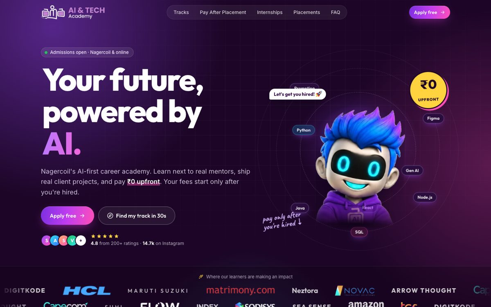
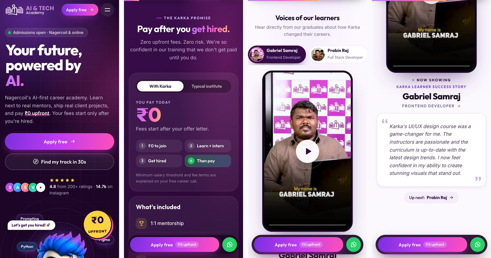

# Karka AI & Tech Academy: website redesign

> **SiteSprint · Karka Infini AI 2026**, problem statement 1:
> *Redesign and develop a modern, responsive, and high-performance website for Karka AI & Tech Academy (karka.academy) that reflects its vibrant brand from Instagram @karka.ai, showcases its career tracks and Pay After Placement model, highlights student placements and real internship projects, and provides a seamless, Gen-Z focused user experience to convert visitors into enrollments.*

A **Python FastAPI** web app with server-rendered pages, motion-rich design, and lead capture built in.
It's designed mobile-first and has been checked to stay smooth on older phones.

**Live demo:** https://yhnol5ogn6hg3cs64cxcoza46q0pwpjr.lambda-url.ap-southeast-2.on.aws/ (AWS Lambda, Sydney)
**Built by:** [Athokpam Yaraba Luwang](https://www.linkedin.com/in/yaraba-athokpam-856538343/)





---

## How it answers the brief

| Brief asks for | What's built |
|---|---|
| **Modern, responsive** | Mobile-first layout from 360px phones to 1440px+ desktops. Fluid type (`clamp`), bottom-sheet quiz on phones, sticky thumb-zone "Apply" dock with WhatsApp. No horizontal scroll at any width (checked automatically). |
| **High-performance** | ~47 KB gzipped for HTML + CSS + JS. Images are lean WebP: the 3D mascot is 27 KB on phones (54 KB on desktop, picked via `srcset`) and partner logos are 5–13 KB each, lazy-loaded where possible. Icons and mock-ups are inline SVG/CSS. Non-blocking fonts, fingerprinted assets with 1-year immutable caching, GZip. See [Performance](#performance-on-older-phones). |
| **Vibrant @karka.ai brand** | The official AI & TECH Academy logo (recoloured for dark backgrounds), Karka's plum/purple palette, the **3D blue-haired AI bot mascot** (cut out to a transparent WebP; it floats, sways and casts a ground shadow), a favicon built from the logo's monitor icon, real colour partner logos, the purple-ribbon **"Got Placed"** cards from their Instagram posts, IG bio lines in the ticker, and Instagram-style **stories** for testimonials. |
| **Career tracks** | 8 tracks / 21 programs in an animated tab switcher, 6 detailed course pages (`/courses/<slug>`) with curriculum, tools, roles and `Course` schema, plus "smart combos". |
| **Pay After Placement** | A signature section: interactive **"With Karka vs Typical institute"** toggle (₹0 vs full fee), a 3-step journey with a path that draws on scroll, a "what's included" list, and a ₹0 stat that counts *down* from ₹1,00,000. |
| **Video testimonials** | "Voices of our learners": 5 real student videos in a phone-frame player with a learner list, "Now playing" quote panel, progress bar, mute, auto-advance to the next learner, and pause when scrolled away. Videos are re-encoded to 540×960 (≈1–3.4 MB) with poster frames and `preload="none"`, so nothing downloads until someone taps play. |
| **Student placements** | Real placements from @karka.ai (Subashini M → DigitKode, Safin Jefferson A → Neztora, V. Sabinesh → Maruti Suzuki …) in an auto-scrolling "Got Placed" wall, plus two offset hiring-partner strips with real colour logos. |
| **Real internship projects** | Internship section with perks, a Brief → Sprint → Demo → Ship flow, a live "Just in" card (Shenbaga Janani A S → AgileTribers), and a project wall of app-window mock-ups. |
| **Gen-Z UX** | Rotating hero word, stickers and hand-written notes, a crossing ticker, a **30-second Track Finder quiz** that recommends a track and pre-fills the form, IG-style stories (tap / hold-to-pause), and a confetti success state. |
| **Convert visitors into enrollments** | A lead form on every page (home, course pages, `/apply` link-in-bio page) that works **with or without JavaScript**. Server-side validation, honeypot and rate limiting, SQLite storage, and a password-protected **lead inbox with CSV export** at `/admin/leads` (sign in at `/admin/login`). WhatsApp, click-to-call and a Google Map everywhere it helps. |
| **SEO** | Per-page titles and descriptions, canonical URLs, Open Graph image, JSON-LD (`EducationalOrganization`, `FAQPage`, `Course`), `sitemap.xml`, `robots.txt`, web manifest, semantic HTML. |

---

## Motion design principles

Every animation runs on **`transform` / `opacity` only**, so the GPU compositor handles it and layout and paint stay idle.

* **Choreographed hero**: the headline lines rise out of masks in sequence, then the sub-copy, CTAs and social proof follow. The mascot pops in with a spring, the ₹0 sticker drops and wiggles, and the speech bubble arrives last.
* **Easing language**: `cubic-bezier(.16,1,.3,1)` (expo-out) for entrances and `cubic-bezier(.34,1.56,.64,1)` (spring) for playful pops: the tab ink, toggle pill and stickers.
* **Scroll reveals**: one `IntersectionObserver` fades and lifts content in with per-item stagger. The strike-through lines in "Why Karka exists" draw themselves, and the PAP journey path draws in using `stroke-dashoffset`.
* **Meaningful motion**: the ₹0 counter counts down (fees disappearing), the compare toggle swaps timelines, and stories show progress bars.
* **Desktop-only delight**: magnetic buttons, cursor spotlight cards and hero parallax. These are enabled only for `(hover: hover) and (pointer: fine)`.

## Performance on older phones

Three tiers, chosen automatically in a tiny inline `<head>` script:

1. **Full**: everything above.
2. **Lite** (`html.lite`): enabled for low-memory devices (`deviceMemory ≤ 2`, or ≤ 4 GB with ≤ 4 cores), Data Saver, 2G, or reduced-motion. It stops decorative infinite loops (orbits, glows, sheen) and drops `backdrop-filter` and mask effects. Reveals become simple fades.
3. **Reduced motion**: respects `prefers-reduced-motion`. Animation is effectively off and marquees become scrollable rows.

On top of that:

* Infinite animations **pause when their section is off-screen** (`.paused` toggled by `IntersectionObserver`), which saves battery and GPU.
* Blob glows are `radial-gradient`s, not `filter: blur()` (blur filters are expensive on mobile GPUs).
* No scroll-jacking. The scroll listener is passive and batched with `requestAnimationFrame`, and the progress bar uses CSS scroll-timelines.
* Inputs are 16px, so iOS doesn't zoom on focus. Touch targets are ≥ 44px.

Measured with Playwright in Chromium at **6× CPU throttling** (budget-phone class), scrolling the whole home page:

| Mode | Median frame | ≈ FPS |
|---|---|---|
| Lite | 16.7 ms | 60 |
| Full | 33 ms | 30 |

Force a mode for testing with `?lite=1` or `?lite=0`.

---

## Run it

```bash
python -m venv .venv && source .venv/bin/activate
pip install -r requirements-dev.txt
uvicorn app.main:app --reload
# open http://127.0.0.1:8000
```

Run the tests:

```bash
pytest -q
```

### Environment variables

| Variable | Purpose | Default |
|---|---|---|
| `ADMIN_PASSWORD` | Enables the lead inbox: sign in at `/admin/login`, then `/admin/leads`. Unset = admin disabled (404). | unset |
| `ADMIN_USER` | Username for script access via HTTP Basic (e.g. `curl -u admin:… /admin/leads.csv`) | `admin` |
| `DATA_DIR` | Where `leads.db` (SQLite) is stored | `./data` |
| `DEV` | Re-hash static assets on every request while editing CSS/JS | unset |

## Deploy

### AWS Lambda (how the live demo runs)

Anyone can deploy their own copy into their own AWS account. You need the AWS CLI v2, Python 3.12+, and `zip`.

```bash
aws login                      # or `aws configure` with an access key
./deploy/deploy_lambda.sh      # prints your public URL at the end
```

The script builds a Linux arm64 package, then creates the IAM role, the Lambda function (Python 3.13) and a public Function URL on the first run. Later runs update the same function.
`app/lambda_handler.py` adapts FastAPI to Lambda via Mangum. Change region or name with `AWS_REGION=ap-south-1 FUNCTION=my-karka ./deploy/deploy_lambda.sh`.
A random lead-inbox password is generated into `deploy/.admin-password` (git-ignored, never committed). Leads live in Lambda's `/tmp`, so they're temporary.

### Other hosts

* **Render**: push to GitHub, then *New → Blueprint* (uses `render.yaml`; `ADMIN_PASSWORD` is auto-generated).
* **Railway / Heroku-style**: uses the `Procfile`.
* **Docker**: `docker build -t karka . && docker run -p 8000:8000 -e ADMIN_PASSWORD=change-me karka`

> On free tiers the disk is ephemeral, so SQLite leads reset on redeploy. Mount a persistent disk at `DATA_DIR` (Render: *Disks*) or export the CSV regularly.

---

## Project structure

```
app/
  main.py          FastAPI app: pages, lead API, admin, SEO routes, caching + security headers
  data.py          All site content (courses, placements, testimonials, FAQ…), edit copy here
  storage.py       SQLite lead store
  lambda_handler.py  AWS Lambda entry point (Mangum)
  icons.py         Inline SVG icon set
  templates/       Jinja2 templates (base, index, course, apply, thank_you, 404, admin, partials)
  static/css/      main.css: design tokens, components, motion, lite / reduced-motion tiers
  static/js/       main.js: reveals, tabs, quiz, stories, forms, dock (vanilla, no deps)
  static/img/      logo, 3D mascot, partner logos, favicons, Open Graph card
  static/video/    learner video testimonials (540×960 MP4) + poster frames
deploy/            deploy_lambda.sh: one-command AWS Lambda deploy
tests/             pytest suite (pages, lead API, validation, rate limit, admin, SEO)
tools/             make_images.py: regenerates the OG share image from the logo + mascot
```

## Routes

| Route | Description |
|---|---|
| `GET /` | Home |
| `GET /courses/{slug}` | Course detail (featured courses); other programs redirect to `/apply?program=…` |
| `GET /apply` | Standalone apply page (good as an Instagram link-in-bio) |
| `POST /api/leads` | JSON lead capture → `201 {ok, id, first_name}` or `422 {errors}` |
| `POST /apply` | Form-encoded fallback for no-JS browsers → redirects to `/thank-you` |
| `GET /admin/login`, `/admin/logout` | Sign in / out of the lead inbox (signed, HttpOnly session cookie) |
| `GET /admin/leads`, `/admin/leads.csv` | Lead inbox and CSV export (requires `ADMIN_PASSWORD`) |
| `GET /api/courses` | Tracks and courses as JSON |
| `GET /sitemap.xml`, `/robots.txt`, `/manifest.webmanifest`, `/healthz` | SEO / PWA / health |

## Content sources & notes

Content comes from karka.academy, infini.karka.academy, Instagram @karka.ai and the Karka LinkedIn page:
courses, durations, enrollment counts, testimonials, placements, stats, FAQ answers and contact details.

Before going live, the academy should review:

* **Course curriculum outlines** on the detail pages are structured from the stack each course lists. Confirm module names with the trainers.
* **Project wall** (`PROJECTS` in `data.py`) shows *types* of intern projects. Swap in real client projects and links.
* Placement cards use initials instead of student photos. Add consented photos if wanted.

## Credits

Designed and built by **[Athokpam Yaraba Luwang](https://www.linkedin.com/in/yaraba-athokpam-856538343/)** for SiteSprint, Karka Infini AI 2026.

The Karka logo, mascot, student testimonial videos, placement details and partner logos belong to Karka AI & Tech Academy and their respective owners. They're used here only for this competition entry.
